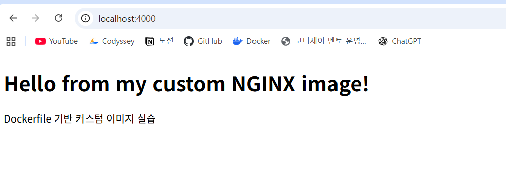
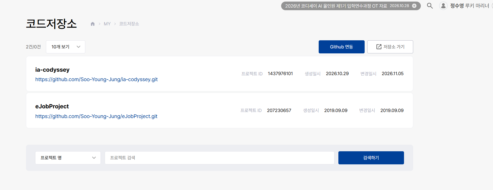

# ia-codyssey
코디세이 학습을 위한 레파지토리


## 1. 프로젝트 개요

본 프로젝트는 개발에 필요한 기본 도구인 Linux CLI, Docker, Git/GitHub를 직접 설치하고 활용하여 개발 워크스테이션 환경을 구축하는 것을 목표로 한다.

터미널을 활용한 디렉토리 및 파일 관리, 권한 설정 실습을 통해 Linux CLI의 기본 사용법을 익히고, Docker를 이용해 컨테이너를 실행하고 관리하는 방법을 학습한다.

또한 Dockerfile을 작성하여 웹 서버를 커스텀 이미지로 제작하고, 포트 매핑을 통한 외부 접속과 바인드 마운트 및 볼륨을 통한 데이터 유지·반영을 검증한다.

마지막으로 Git을 통한 버전 관리와 GitHub 저장소 연동을 수행하고, 모든 실습 과정과 검증 결과를 기술 문서로 기록하여 누구나 동일한 환경을 재현할 수 있도록 한다.

### 프로젝트 목표

Linux CLI를 활용한 파일·디렉토리 관리 및 권한 설정

Docker 설치 및 컨테이너 실행·관리

Dockerfile 기반 커스텀 이미지 제작 및 웹 서버 실행

포트 매핑을 통한 서비스 접속 검증

바인드 마운트 및 Docker 볼륨의 동작과 데이터 영속성 검증

Git/GitHub를 활용한 버전 관리 및 저장소 연동

수행 과정과 검증 결과를 문서화하여 재현 가능한 개발 환경 구축


## 2. 실행환경
- OS: Ubunte 26.04
- Shell: Bash
- Docker: 29.9.2
- Git: 2.56.0


## 3. 체크리스트
- Linux CLI를 활용한 파일·디렉토리 관리 및 권한 설정
- Docker 설치 및 컨테이너 실행·관리
- Dockerfile 기반 커스텀 이미지 제작 및 웹 서버 실행
- 포트 매핑을 통한 서비스 접속 검증
- 바인드 마운트 및 Docker 볼륨의 동작과 데이터 영속성 검증
- Git/GitHub를 활용한 버전 관리 및 저장소 연동


## 4. 검증

### Linux CLI를 활용한 파일·디렉토리 관리 및 권한 설정
```
jsy@JSY:~$ # 현재 위치 확인
jsy@JSY:~$ pwd
/home/jsy

jsy@JSY:~$ # 목록 확인(숨김 파일 포함)
jsy@JSY:~$ ls -a
.  ..  .bash_history  .bash_logout  .bashrc  .cache  .config  .motd_shown  .profile

jsy@JSY:~$ # 빈 파일 생성(파일 생성)
jsy@JSY:~$ touch test.txt
jsy@JSY:~$ ls
test.txt

jsy@JSY:~$ # 파일 내용 확인(빈 텍스트 파일이므로 내용물은 없음)
jsy@JSY:~$ cat test.txt

jsy@JSY:~$ # 파일 복사
jsy@JSY:~$ cp test.txt test2.txt
jsy@JSY:~$ ls
test.txt  test2.txt

jsy@JSY:~$ mkdir test_folder # 파일 이동 검증을 위해 임시 폴더 생성


jsy@JSY:~$ # 이동
jsy@JSY:~$ mv test2.txt test_folder/
jsy@JSY:~$ ls
test.txt  test_folder
jsy@JSY:~$ cd test_folder/
jsy@JSY:~/test_folder$ ls
test2.txt

jsy@JSY:~/test_folder$ # 파일 이름 변경
jsy@JSY:~/test_folder$ mv test2.txt test3.txt
jsy@JSY:~/test_folder$ ls
test3.txt

jsy@JSY:~/test_folder$ cd ..  # 파일 삭제를 위해 상위 디렉토리로 이동

jsy@JSY:~$ # 삭제(test.txt 파일을 삭제)
jsy@JSY:~$ rm test.txt
jsy@JSY:~$ ls
test_folder   # test.txt 파일 삭제됬음을 확인

jsy@JSY:~$ # 권한 확인
jsy@JSY:~$ touch test.txt  # 권한 확인 전 파일 생성
jsy@JSY:~$ ls -l
total 4
-rw-r--r-- 1 jsy jsy    0 Nov  5 14:10 test.txt
drwxr-xr-x 2 jsy jsy 4096 Nov  5 14:13 test_folder

jsy@JSY:~$ # 권한 변경 전 파일 읽기
jsy@JSY:~$ cat test
jsy@JSY:~$ vi test.txt  # test.txt 파일에 임의의 텍스트 내용을 추가
jsy@JSY:~$ cat test.txt # test.txt 파일 읽기
테스트 파일입니다.


jsy@JSY:~$ # 파일 권한 변경(읽기 쓰기 불가하게 변경)
jsy@JSY:~$ chmod 000 test.txt
jsy@JSY:~$ ls -l
total 8
---------- 1 jsy jsy   27 Nov  5 14:36 test.txt
drwxr-xr-x 2 jsy jsy 4096 Nov  5 14:13 test_folder
jsy@JSY:~$ cat test.txt
cat: test.txt: Permission denied  # 이전과 달리 test.txt 파일에 접근이 불가


jsy@JSY:~$ cd test_folder/ # 폴더 권한 변경(접근 불가하게 변경)
jsy@JSY:~/test_folder$ cd ..
jsy@JSY:~$ chmod 000 test_folder/
jsy@JSY:~$ ls -l
total 8
---------- 1 jsy jsy   27 Nov  5 14:36 test.txt
d--------- 2 jsy jsy 4096 Nov  5 14:13 test_folder
jsy@JSY:~$ cd test_folder/
-bash: cd: test_folder/: Permission denied # 이전과 달리 test_folder 폴더에 접근이 불가
```
### Docker 설치 및 컨테이너 실행·관리
```
PS C:\Users\works> # 도커 버전 확인
PS C:\Users\works> docker --version
Docker version 29.9.2, build a82e528

PS C:\Users\works> # 도커 데몬 상태 확인
PS C:\Users\works> docker info
Client:
 Version:    29.9.2
 Context:    desktop-linux
 Debug Mode: false
 Plugins:
  agent: Docker AI Agent Runner (Docker Inc.)
    Version:  v1.152.0
    Path:     C:\Users\works\.docker\cli-plugins\docker-agent.exe
  ai: Docker AI Agent - Ask Gordon (Docker Inc.)
    Version:  v1.33.0
    Path:     C:\Users\works\.docker\cli-plugins\docker-ai.exe
  buildx: Docker Buildx (Docker Inc.)
    Version:  v0.38.1
    Path:     C:\Users\works\.docker\cli-plugins\docker-buildx.exe
  compose: Docker Compose (Docker Inc.)
    Version:  v5.6.1
    Path:     C:\Users\works\.docker\cli-plugins\docker-compose.exe
  debug: Get a shell into any image or container (Docker Inc.)
    Version:  0.49.0
    Path:     C:\Users\works\.docker\cli-plugins\docker-debug.exe
  desktop: Docker Desktop commands (Docker Inc.)
    Version:  4.98.0
    Path:     C:\Users\works\.docker\cli-plugins\docker-desktop.exe
  dhi: CLI for managing Docker Hardened Images (Docker Inc.)
    Version:  v0.0.9
    Path:     C:\Users\works\.docker\cli-plugins\docker-dhi.exe
  extension: Manages Docker extensions (Docker Inc.)
    Version:  v0.2.32
    Path:     C:\Users\works\.docker\cli-plugins\docker-extension.exe
  init: Creates Docker-related starter files for your project (Docker Inc.)
    Version:  v1.4.1
    Path:     C:\Users\works\.docker\cli-plugins\docker-init.exe
  mcp: Docker MCP Plugin (Docker Inc.)
    Version:  v0.44.2
    Path:     C:\Users\works\.docker\cli-plugins\docker-mcp.exe
  model: Docker Model Runner (Docker Inc.)
    Version:  v1.2.9
    Path:     C:\Users\works\.docker\cli-plugins\docker-model.exe
  offload: Docker Offload (Docker Inc.)
    Version:  v0.7.35
    Path:     C:\Users\works\.docker\cli-plugins\docker-offload.exe
  pass: Docker Pass Secrets Manager Plugin (beta) (Docker Inc.)
    Version:  v0.3.2
    Path:     C:\Users\works\.docker\cli-plugins\docker-pass.exe
  sandbox: "docker sandbox" is deprecated, use Docker Sandboxes instead (Docker Inc.)
    Version:  v0.13.0
    Path:     C:\Users\works\.docker\cli-plugins\docker-sandbox.exe
  scout: Docker Scout (Docker Inc.)
    Version:  v1.27.0
    Path:     C:\Users\works\.docker\cli-plugins\docker-scout.exe

Server:
 Containers: 0
  Running: 0
  Paused: 0
  Stopped: 0
 Images: 3
 Server Version: 29.9.2
 Storage Driver: overlayfs
  driver-type: io.containerd.snapshotter.v1
 Logging Driver: local
 Cgroup Driver: cgroupfs
 Cgroup Version: 2
 Plugins:
  Volume: local
  Network: bridge host ipvlan macvlan null overlay
  Log: awslogs fluentd gcplogs gelf journald json-file local splunk syslog
 CDI spec directories:
  /etc/cdi
  /var/run/cdi
 Discovered Devices:
  cdi: docker.com/gpu=webgpu
 Swarm: inactive
 Runtimes: io.containerd.runc.v2 nvidia runc
 Default Runtime: runc
 Init Binary: docker-init
 containerd version: b7a25261e029d68978bbf290df0a62fc819b3c51
 runc version: v1.5.2-0-g29dd3dc2
 init version: de40ad0
 Security Options:
  seccomp
   Profile: builtin
  cgroupns
 Kernel Version: 6.18.54.1-microsoft-standard-WSL2
 Operating System: Docker Desktop
 OSType: linux
 Architecture: x86_64
 CPUs: 28
 Total Memory: 15.47GiB
 Name: docker-desktop
 ID: 2055e93e-1a0e-46d8-b48a-85a6e890855c
 Docker Root Dir: /var/lib/docker
 Debug Mode: false
 HTTP Proxy: http.docker.internal:3128
 HTTPS Proxy: http.docker.internal:3128
 No Proxy: hubproxy.docker.internal
 Labels:
  com.docker.desktop.address=npipe://\\.\pipe\docker_cli
 Experimental: false
 Insecure Registries:
  hubproxy.docker.internal:5555
  127.0.0.0/8
  ::1/128
 Live Restore Enabled: false
 Firewall Backend: iptables

PS C:\Users\works> # 도커 이미지 목록 확인
PS C:\Users\works> docker images
                                                                                                   i Info →   U  In Use
IMAGE                             ID             DISK USAGE   CONTENT SIZE   EXTRA
docker/welcome-to-docker:latest   c4d56c24da4f       22.2MB         6.03MB
nginx:latest                      5ab5b0b01097        243MB         66.8MB

PS C:\Users\works> # 도커 이미지 다운로드(우분투)
PS C:\Users\works> docker pull ubuntu
Using default tag: latest
latest: Pulling from library/ubuntu
f3f25b84a7d7: Pull complete
edafa32f5d9e: Pull complete
21594acc2d8b: Download complete
Digest: sha256:6a06111c3b0a8600feadb270aec771dc239bf407b25625f93f44ab00e11f4d3c
Status: Downloaded newer image for ubuntu:latest
docker.io/library/ubuntu:latest

PS C:\Users\works> docker images
                                                                                                   i Info →   U  In Use
IMAGE                             ID             DISK USAGE   CONTENT SIZE   EXTRA
docker/welcome-to-docker:latest   c4d56c24da4f       22.2MB         6.03MB
nginx:latest                      5ab5b0b01097        243MB         66.8MB
ubuntu:latest                     6a06111c3b0a        163MB         45.9MB


PS C:\Users\works> # 도커 실행중인 컨테이너 확인
PS C:\Users\works> docker ps
CONTAINER ID   IMAGE     COMMAND   CREATED   STATUS    PORTS     NAMES


PS C:\Users\works> # 도커 실행중지된 컨테이너를 포함하여 확인
PS C:\Users\works> docker ps -a
CONTAINER ID   IMAGE     COMMAND   CREATED   STATUS    PORTS     NAMES


PS C:\Users\works> # hello-world 실행
PS C:\Users\works> docker run hello-world
Unable to find image 'hello-world:latest' locally
latest: Pulling from library/hello-world
4f55086f7dd0: Pull complete
d5e71e642bf5: Download complete
Digest: sha256:c567b231f65614688711a75f31518a064258a51d442117a3e771a3a8fdba78ef
Status: Downloaded newer image for hello-world:latest

Hello from Docker!
This message shows that your installation appears to be working correctly.

To generate this message, Docker took the following steps:
 1. The Docker client contacted the Docker daemon.
 2. The Docker daemon pulled the "hello-world" image from the Docker Hub.
    (amd64)
 3. The Docker daemon created a new container from that image which runs the
    executable that produces the output you are currently reading.
 4. The Docker daemon streamed that output to the Docker client, which sent it
    to your terminal.

To try something more ambitious, you can run an Ubuntu container with:
 $ docker run -it ubuntu bash

Share images, automate workflows, and more with a free Docker ID:
 https://hub.docker.com/

For more examples and ideas, visit:
 https://docs.docker.com/get-started/


PS C:\Users\works> # 우분투 컨테이너 생성
PS C:\Users\works> docker run -dit --name ubuntu-test ubuntu
449035724ae36c36fcc3b384e27100a6122bda7b84d0fbac19e5f1cce207095e

PS C:\Users\works> # 우분투 exec 를 통한 진입 명령
PS C:\Users\works> docker exec -it ubuntu-test bash
root@449035724ae3:/# ls
bin  boot  dev  etc  home  lib  lib64  media  mnt  opt  proc  root  run  sbin  srv  sys  tmp  usr  var
root@449035724ae3:/# echo "hello-world"
hello-world
root@449035724ae3:/# exit
exit

What's next:
    Try Docker Debug for seamless, persistent debugging tools in any container or image → docker debug ubuntu-test
    Learn more at https://docs.docker.com/go/debug-cli/

# 우분투에서 exit 를 통해 나와도 컨테이너가 종료되지 않고 계속 작동중임

PS C:\Users\works> docker attach ubuntu-test # 우분투 attach 를 통한 진입 명령
root@449035724ae3:/# ls
bin  boot  dev  etc  home  lib  lib64  media  mnt  opt  proc  root  run  sbin  srv  sys  tmp  usr  var
root@449035724ae3:/# echo "hello-world"
hello-world
root@449035724ae3:/# exit
exit

PS C:\Users\works> docker ps
CONTAINER ID   IMAGE     COMMAND   CREATED   STATUS    PORTS     NAMES

# attach 를 통해 진입후 exit 시 컨테이너도 같이 종료


PS C:\Users\works> # 도커 로그 확인
PS C:\Users\works> docker logs ubuntu-test
root@449035724ae3:/# ls
bin  boot  dev  etc  home  lib  lib64  media  mnt  opt  proc  root  run  sbin  srv  sys  tmp  usr  var
root@449035724ae3:/# exit
exit
root@449035724ae3:/# echo hello-world
hello-world
root@449035724ae3:/#
exit
root@449035724ae3:/# echo hello-world
hello-world

PS C:\Users\works> # 도커 리소스 확인
PS C:\Users\works> docker stats
CONTAINER ID   NAME          CPU %     MEM USAGE / LIMIT     MEM %     NET I/O         BLOCK I/O   PIDS
449035724ae3   ubuntu-test   0.00%     1.949MiB / 15.47GiB   0.01%     1.17kB / 126B   0B / 0B     1

```


### Dockerfile 기반 커스텀 이미지 제작 및 웹 서버 실행

#### 커스텀 이미지 기반
- 기반 이미지: nginx

#### 커스텀 포인트 및 목적
- 이미지 내에 웹서버 접속시 메인으로 띄워주는 index.html 파일을 수정 - 정적인 컨텐츠 변경을 위한 목적
- 이미지 내에 기본적으로 index.html 이라는 파일을 메인으로 띄워주도록 설정되어있는데 해당 설정을 test_index.html 파일로 바꾸도록 변경 - 설정을 변경하기 위한 목적

#### 프로젝트 디렉토리 구조 추가
```
docker-nginx/                 # 프로젝트 루트 디렉토리
├── Dockerfile                # 커스텀 이미지 빌드 설정
├── default.conf              # NGINX 웹 서버 설정 파일
└── index.html                # 웹 서버에서 제공할 정적 HTML 콘텐츠
```

### 프로젝트 디렉토리 구조 및 파일 배치 기준

본 프로젝트는 NGINX 기반의 커스텀 Docker 이미지를 제작하기 위한 프로젝트로, 이미지 빌드에 필요한 파일들을 하나의 프로젝트 루트 디렉토리에 배치하였다.

별도의 하위 디렉토리를 생성하지 않고 루트 디렉토리에 파일을 배치한 이유는 현재 프로젝트의 구성 요소가 Dockerfile, NGINX 설정 파일, 정적 HTML 파일로 한정되어 있어 간단한 구조로 관리하는 것이 효율적이기 때문이다.

**프로젝트 디렉토리 구조**

```text
docker-nginx/
├── Dockerfile
├── default.conf
└── index.html
```

**파일별 역할 및 배치 이유**

| 파일명 | 역할 | 배치 이유 |
|---|---|---|
| Dockerfile | NGINX 기반 커스텀 이미지 빌드 명령 정의 | Docker 이미지 빌드의 기준 파일이므로 프로젝트 루트에 배치 |
| default.conf | NGINX 웹 서버의 기본 설정 변경 | 컨테이너 내부의 `/etc/nginx/conf.d/` 경로에 복사하여 적용하기 위해 루트에 배치 |
| index.html | 웹 서버에서 사용자에게 제공할 정적 웹 콘텐츠 | 컨테이너 내부의 `/usr/share/nginx/html/` 경로에 복사하여 제공하기 위해 루트에 배치 |

**파일 간 동작 관계**

1. Dockerfile에서 기존 `nginx:latest` 이미지를 베이스 이미지로 지정한다.
2. `COPY` 명령을 통해 `index.html`을 컨테이너 내부의 `test_index.html`로 복사한다.
3. `COPY` 명령을 통해 `default.conf`를 NGINX 설정 디렉토리에 복사한다.
4. NGINX는 변경된 설정에 따라 웹 서버 접속 시 `test_index.html`을 기본 페이지로 제공한다.

이와 같이 프로젝트 루트에 빌드 관련 파일을 모아 관리함으로써 Docker 빌드 컨텍스트를 단순화하고, 파일 관리 및 이미지 재빌드가 용이하도록 구성하였다.


```
# Dockfile 커스텀 이미지 제작을 위한 디렉토리 생성
jsy@JSY:~$ mkdir -p ~/docker-nginx
cd ~/docker-nginx

# 커스텀 이미지의 정적인 컨텐츠 변경을 위해 index.html 파일 생성
jsy@JSY:~/docker-nginx$ cat > index.html <<'EOF'
<!DOCTYPE html>
<html lang="ko">
<head>
    <meta charset="UTF-8">
    <title>Custom NGINX</title>
</head>
<body>
    <h1>Hello from my custom NGINX image!</h1>
    <p>Dockerfile 기반 커스텀 이미지 실습</p>
</body>
</html>
EOF
jsy@JSY:~/docker-nginx$ ls
index.html
jsy@JSY:~/docker-nginx$ cat index.html
<!DOCTYPE html>
<html lang="ko">
<head>
    <meta charset="UTF-8">
    <title>Custom NGINX</title>
</head>
<body>
    <h1>Hello from my custom NGINX image!</h1>
    <p>Dockerfile 기반 커스텀 이미지 실습</p>
</body>
</html>

# 커스텀 이미지의 설정을 변경하기 위해 default.conf 파일 생성
jsy@JSY:~/docker-nginx$ cat > default.conf <<'EOF'
server {
    listen 80;
    server_name localhost;

    location / {
        root /usr/share/nginx/html;
        index test_index.html; # 기존 index.html 이였으나 test_index.html 로 변경
    }
}
EOF

# 최종적으로 커스텀 이미지 생성을 위한 Dockerfile 작성
jsy@JSY:~/docker-nginx$ cat > Dockerfile <<'EOF'
FROM nginx:latest

COPY index.html /usr/share/nginx/html/test_index.html # 컨테이너 생성시 test_index.html 이라는 파일을 생성
COPY default.conf /etc/nginx/conf.d/default.conf
EOF
# 파일 3개 확인 가능
jsy@JSY:~/docker-nginx$ ls
Dockerfile  default.conf  index.html

# nginx 를 기반으로 한 커스텀 이미지 생성
jsy@JSY:~/docker-nginx$ docker build -t custom-nginx .
[+] Building 4.3s (8/8) FINISHED                                                                   docker:desktop-linux
 => [internal] load build definition from Dockerfile                                                               0.1s
 => => transferring dockerfile: 154B                                                                               0.0s
 => [internal] load metadata for docker.io/library/nginx:latest                                                    0.1s
 => [internal] load .dockerignore                                                                                  0.1s
 => => transferring context: 2B                                                                                    0.0s
 => [1/3] FROM docker.io/library/nginx:latest@sha256:5ab5b0b01097420873a3f3330f44248e34a3c2a3e8d5ee30658aeae8cb74  2.6s
 => => resolve docker.io/library/nginx:latest@sha256:5ab5b0b01097420873a3f3330f44248e34a3c2a3e8d5ee30658aeae8cb74  0.1s
 => => extracting sha256:6fc242d221a673263eabd14a9ad9584d3177c96e5cb504c891497338e2f912f5                          1.0s
 => => extracting sha256:a071113ac575190a0fee0c046bcf51632356f07419bdffaa55798f54e5b2e23b                          1.0s
 => => extracting sha256:9f604dae09b216f6c87919d0e59d5a4ddc4387ef071cf63c645628f93808e37b                          0.0s
 => => extracting sha256:6e2ab1f3ef4e0ea3bbe1d208dfa048969199e3dab99e93c051b7c2d09c8efb3e                          0.0s
 => => extracting sha256:c139fe92686de21a8c49d9cb40415d1dddd95fbbee4d696cebe37693236fe6d4                          0.0s
 => => extracting sha256:d322f1bf41d8e99dc47f550cbf85e79ca18bc45db12fd1b7a8b34bf79cbd7d5a                          0.0s
 => => extracting sha256:a670537bed7086aeb8b663aad5e09cd584e19c6598cd2b6d905c5f2f2513938b                          0.0s
 => [internal] load build context                                                                                  0.2s
 => => transferring context: 456B                                                                                  0.0s
 => [2/3] COPY index.html /usr/share/nginx/html/index.html                                                         0.4s
 => [3/3] COPY default.conf /etc/nginx/conf.d/default.conf                                                         0.1s
 => exporting to image                                                                                             0.6s
 => => exporting layers                                                                                            0.3s
 => => exporting manifest sha256:83249349451446a73ee554684e252a07f30756ecaeaaac9fc58176a1917623d3                  0.0s
 => => exporting config sha256:a8c410494a3cedd3ac7f8d6027fa5c4d97fc98d00511dc41e99aa757173be3e5                    0.0s
 => => exporting attestation manifest sha256:f8670541af07621975f9229a03bee1ae50a9fbdcea4528f6cad0d7a229cbb466      0.1s
 => => exporting manifest list sha256:f563fbdbae9c6c52c328eb4dcf82db6791bb9eafaf62ac6222352b38645cbd2c             0.0s
 => => naming to docker.io/library/custom-nginx:latest                                                             0.0s
 => => unpacking to docker.io/library/custom-nginx:latest                                                          0.1s

View build details: docker-desktop://dashboard/build/desktop-linux/desktop-linux/4cneaps73a9wigfkdq2e4mw5g

# 아래는 파워 쉘 명령어 커스텀 이미지가 정상적으로 생성된것을 확인
PS C:\Users\works> docker images
                                                                                                    i Info →   U  In Use
IMAGE                             ID             DISK USAGE   CONTENT SIZE   EXTRA
custom-nginx:latest               f563fbdbae9c        241MB         63.9MB
docker/welcome-to-docker:latest   c4d56c24da4f       22.2MB         6.03MB
hello-world:latest                c567b231f656       25.9kB         9.49kB    U
nginx:latest                      5ab5b0b01097        243MB         66.8MB
ubuntu:latest                     6a06111c3b0a        163MB         45.9MB    U


```


#### Docker 이미지와 컨테이너의 차이

Docker 이미지와 컨테이너는 서로 밀접한 관계가 있지만 역할에는 차이가 있다.

- **빌드 관점:** Dockerfile에 작성된 설정과 파일을 기반으로 `docker build` 명령을 실행하여 Docker 이미지를 생성한다. 본 실습에서는 기존 `nginx:latest` 이미지를 기반으로 정적 HTML 파일과 NGINX 설정을 추가하여 `custom-nginx` 이미지를 제작
- **실행 관점:** 생성된 이미지는 `docker run` 명령을 통해 컨테이너로 생성되며, 컨테이너 내부에서 실제 NGINX 웹 서버 프로세스가 실행

따라서 Docker 이미지는 애플리케이션 실행을 위한 기반 환경이고, 컨테이너는 해당 이미지를 기반으로 실제 애플리케이션을 실행하는 환경


### 포트 매핑을 통한 서비스 접속 검증

```
# 포트 매핑은 4000:80 으로 설정
PS C:\Users\works> docker run -d --name custom-nginx-container -p 4000:80 custom-nginx
50e7fe9b28bc0758071ae409e1e8ae7f1317d955a589c27ba2d782d61cb1123c

PS C:\Users\works> docker ps
CONTAINER ID   IMAGE          COMMAND                  CREATED             STATUS             PORTS                                     NAMES
50e7fe9b28bc   custom-nginx   "/docker-entrypoint.…"   4 seconds ago       Up 5 seconds       0.0.0.0:4000->80/tcp, [::]:4000->80/tcp   custom-nginx-container
449035724ae3   ubuntu         "/bin/bash"              About an hour ago   Up About an hour   

```

#### 웹서버 접속 화면

포트번호를 4000으로 설정하였으므로 localhost:4000 으로 접속하였음을 확인 가능함


### 바인드 마운트 및 Docker 볼륨의 동작과 데이터 영속성 검증

```
PS C:\Users\works> # 도커 볼륨 생성
PS C:\Users\works> docker volume create test-data
test-data
PS C:\Users\works> # 도커 볼륨 생성 확인

PS C:\Users\works> docker volume ls
DRIVER    VOLUME NAME
local     test-data

PS C:\Users\works> # 컨테이너 생성
PS C:\Users\works> docker run -d --name nginx-volume -p 8081:80 --mount type=volume,source=test-data,target=/usr/share/nginx/html nginx
aeed86e5e8e27ea3e1ff168ae5f78e9bb134f2efd7b64dd15859d36cc3be059a


PS C:\Users\works> docker exec -it nginx-volume bash # 컨테이너 내부에 접속하여 파일 내용 수정
root@aeed86e5e8e2:/# echo '<h1>Docker Volume Persistence Test</h1>' > /usr/share/nginx/html/index.html
root@aeed86e5e8e2:/# cat /usr/share/nginx/html/index.html
<h1>Docker Volume Persistence Test</h1>  # 내용이 변경됬음을 확인
root@aeed86e5e8e2:/# exit

# 기존에 생성했던 컨테이너 정지/삭제
PS C:\Users\works> docker stop nginx-volume
nginx-volume
PS C:\Users\works> docker rm nginx-volume
nginx-volume
PS C:\Users\works> docker ps -a
CONTAINER ID   IMAGE          COMMAND                  CREATED       STATUS                     PORTS     NAMES
50e7fe9b28bc   custom-nginx   "/docker-entrypoint.…"   2 hours ago   Exited (0) 2 hours ago               custom-nginx-container
449035724ae3   ubuntu         "/bin/bash"              4 hours ago   Exited (137) 2 hours ago             ubuntu-test
127e89eb652c   hello-world    "/hello"                 4 hours ago   Exited (0) 4 hours ago               frosty_kirch

# 같은 볼륨을 대상으로 컨테이너 생성 및 볼륨 영속성 검증
PS C:\Users\works> docker run -d --name nginx-volume2 -p 8082:80 --mount type=volume,source=test-data,target=/usr/share/nginx/html nginx
5446aa673c622d68d6be25e1d1da2e22e51d9e9848295ff818f2dac2c0428550
PS C:\Users\works> docker exec -it nginx-volume2 bash
root@5446aa673c62:/# cat /usr/share/nginx/html/index.html
<h1>Docker Volume Persistence Test</h1>
root@5446aa673c62:/# exit
exit

```


### Git/GitHub를 활용한 버전 관리 및 저장소 연동

#### Git 사용자 정보/기본 브랜치 설정
```
$ git config --list
diff.astextplain.textconv=astextplain
filter.lfs.clean=git-lfs clean -- %f
filter.lfs.smudge=git-lfs smudge -- %f
filter.lfs.process=git-lfs filter-process
filter.lfs.required=true
http.sslbackend=schannel
core.autocrlf=true
core.fscache=true
core.symlinks=false
pull.rebase=false
credential.helper=manager
credential.https://dev.azure.com.usehttppath=true
init.defaultbranch=master
core.editor="C:\Users\works\AppData\Local\Programs\Microsoft VS Code\bin\code" --wait
user.name=Soo-Young-Jung
user.email=kscorponok@gmail.com
init.defaultbranch=main
core.repositoryformatversion=0
core.filemode=false
core.bare=false
core.logallrefupdates=true
core.symlinks=false
core.ignorecase=true
remote.origin.url=https://github.com/Soo-Young-Jung/ia-codyssey
remote.origin.fetch=+refs/heads/*:refs/remotes/origin/*

$ git remote -v
origin  https://github.com/Soo-Young-Jung/ia-codyssey (fetch)
origin  https://github.com/Soo-Young-Jung/ia-codyssey (push)


$ git log
commit 9b24057d8f3dd6d5ab82f7d45ecbc625240498b0 (HEAD -> main)
Author: Soo-Young-Jung <kscorponok@gmail.com>
Date:   Mon Nov 9 15:14:40 2026 +0900

    test


```


#### 코드저장소 연동 증거



## 5. 트러블슈팅

### 5-1. docker 명령어 실행 문제

```
PS C:\Users\works> docker ps
failed to connect to the docker API at npipe:////./pipe/dockerDesktopLinuxEngine; check if the path is correct and if the daemon is running: open //./pipe/dockerDesktopLinuxEngine: The system cannot find the file specified.
```
- 문제 : 도커 명령어 실행시 작동을 실패하는 문제
- 원인 및 조치 : Docker Desktop 이 실행되지 않으면 도커 관련 명령어가 실행되지 않는 문제임을 확인, docker 관련 작업시 Docker Desktop 을 미리 실행하도록 조치


